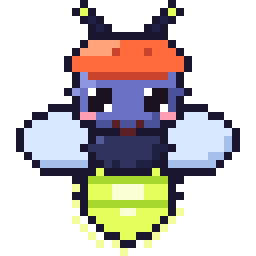

# oksl



**A shader compiler you embed in your app.** oksl compiles a small, safe
shading language at runtime, through one front end, from SkSL (the
language of Skia's runtime effects), GLSL ES 3 as Shadertoy writes it, or
plain GLSL ES 3.0 fragment shaders, into:

- **SPIR-V** for Vulkan,
- **MSL** for Metal,
- a **CPU program** that renders the same shader with no GPU at all.

It's plain Odin with no external toolchain. Runtime shaders usually mean
shipping glslang, shaderc, SPIRV-Cross, DXC or Slang; with oksl the compiler
is part of your binary, so nobody installs anything. The library depends on
`core:` only; the tools also use `vendor:sdl3` and `vendor:stb`.

## Who it's for

- **SDL_GPU apps** that want shaders compiled at runtime on every platform,
  instead of shipping pre-built blobs made offline with SDL_shadercross.
- **Games and engines:** hot-reloaded shaders while developing, modding and
  player-made effects. The language has no pointers or memory access beyond
  its inputs, which is why Skia uses SkSL for runtime effects (see
  Limitations about loops before running untrusted code).
- **Creative coding and VJ tools:** a Shadertoy-style playground in your
  own app.
- **UI frameworks:** custom effects (ripples, blurs, gradients, glows) as
  small shaders, the way Flutter uses Skia's runtime effects.
- **Headless rendering and tests:** the CPU interpreter renders the same
  effect on machines without a GPU (servers, CI) and gives a reference for
  golden-image tests. `tools/gpu_parity` checks GPU against CPU.
- **Learning:** a small, readable compiler from source to real GPU code.

Relatives: Skia's SkSL runtime effects, naga (wgpu's shader translator),
SDL_shadercross. oksl's niche is Odin-native, tiny, runtime, with a CPU
fallback. It started as the shader engine of
[onimite](https://github.com/defnotmid/onimite) (video from Lua scripts), where it compiles
fframes' SkSL shaders unchanged; [demo/](demo) is an onimite video about it.

## Use

```odin
m, errors, ok := oksl.compile(source)            // SkSL
// m, errors, ok := oksl.compile_shadertoy(glsl) // Shadertoy GLSL (Options.profile = .Shadertoy)
// m, errors, ok := oksl.compile_glsl(frag)      // GLSL ES 3.0 fragment shader (Options.profile = .Glsl)
defer oksl.destroy(m)
if !ok {
	// Errors are values ({pos, code, operands}); text is made here.
	fmt.eprint(oksl.format_errors(errors))   // "12:7: undeclared identifier \"foo\""
	return
}
// GPU: SDL_CreateGPUShader with m.spirv (entry oksl.SPIRV_ENTRY) or m.msl
// (entry oksl.MSL_ENTRY), num_samplers = m.num_samplers, num_uniform_buffers = 1;
// vertex shader oksl.LAYER_VERTEX_SPIRV / LAYER_VERTEX_MSL.
// CPU:
block := make([]u8, m.block_size)
oksl.write_builtins(block, {resolution = {f32(w), f32(h), 1}, time = t, channel_resolution = {{tw, th, 1}, {}, {}, {}}})
// or one input at a time: oksl.write_input(block, .Channel_Time, {clip_seconds}, 0)
oksl.set_uniform(m, block, "uSpeed", {0.5})
scratch: oksl.Scratch                      // working memory, one per thread
defer oksl.scratch_destroy(&scratch)
oksl.run(&m.program, block, w, h, pixels, w * 4, &scratch, {sampler = my_sampler})
```

A Shadertoy multipass program (Common, Buffer A-D, Image) compiles into a
pass table and an edge array:

```odin
desc := oksl.Program_Desc{common = common_src}
desc.sources[.Buffer_A] = trail_src
desc.sources[.Image] = image_src
desc.channels[.Buffer_A][0] = {.Buffer, u8(oksl.Pass_Kind.Buffer_A)} // itself: the previous frame
desc.channels[.Image][0] = {.Buffer, u8(oksl.Pass_Kind.Buffer_A)}    // this frame's
desc.channels[.Image][1] = {.External, 7}                            // the host's input 7
g, errors, ok := oksl.compile_program(desc)  // errors: "Buffer A:3:9: ..."
defer oksl.destroy_program(g)
for pass, i in g.passes {                    // buffers (A..D), then Image
	for e in g.edges[pass.edges.start:][:pass.edges.count] {
		// e.channel reads: e.source = .Buffer (pass e.id, this frame),
		// .Previous (pass e.id, last frame) or .External (input e.id)
	}
	// run pass.module like any module, into a float target for buffers
}
```

## Language

### SkSL

SkSL as Skia's runtime effects accept it (with ES3-style extensions where
they cost nothing):

- **Entry point:** `half4 main(float2 coord)` (`float4`/`vec4` and
  `vec2` spellings too). `coord` is the position in layer units (pixel
  centres, origin top-left; the host's `iResolution` scales uv to it). The
  result is premultiplied RGBA.
- **Types:** `bool int uint float half` (`half` is `float`: everything is
  32-bit), vectors `float2..4`, `half2..4`, `int2..4`, `uint2..4`,
  `bool2..4`, matrices `float2x2..float4x4` / `halfNxM` (column-major, N
  columns of M rows), the GLSL spellings `vec3`, `ivec2`, `mat3`, `mat2x4`
  ..., structs, and constant-size arrays (dynamic indexing allowed, no
  arrays of arrays).
- **Uniforms:** scalars, vectors, matrices and arrays of them;
  `layout(...)` qualifiers (`layout(color)`) are accepted and ignored. A
  uniform declared with the name and type of an input row (`float3
  iResolution`, `float iTime`, `int iFrame`, ...: the table below) binds
  to that slot; declared with another type it is an ordinary uniform the
  host fills by name.
- **Children:** `uniform shader name;` (up to four, channels in
  declaration order). `name.eval(p)` samples the child at `p` in the
  child's own pixels: it lowers to an explicit-lod sample at `p /
  childSize` (the size comes from the block), bilinear and clamped by the
  host's sampler, like Skia's image shaders.
- **Expressions and statements:** the usual operators, swizzles (`xyzw`,
  `rgba`, `stpq`) for reading and writing, constructors with flattening,
  `?:`, `,`, `.length()`, `if/else`, `for`, `while`, `do-while`, `switch`
  (int or uint, constant labels, fallthrough), `break`, `continue`,
  `return`, `const`, `in`/`out`/`inout` parameters, overloads, prototypes
  and calls before definitions. Implicit `int -> uint -> float`
  conversions are accepted. Recursion is an error.
- **Built-ins:** SkSL's intrinsics (the GLSL ES 3 math, geometric, matrix,
  vector-relational and bit-cast functions, `saturate`), `sk_FragCoord`
  (`float4(coord, 0, 1)`: the layer is its own device), and the extensions
  `dFdx`, `dFdy`, `fwidth`.
- **Diagnosed:** SkSL has no preprocessor (`#version` lines are skipped,
  any other directive is an error), no `discard`, no `sampler2D` /
  `texture()` (use `uniform shader` and `.eval`), no `colorFilter` /
  `blender` children, no shader parameters, and `mainImage` is not an entry
  point (compile Shadertoy code through `compile_shadertoy`). Errors are
  `line:column: message`; several are collected per compile.

### GLSL (Shadertoy)

`compile_shadertoy` (or `Options.profile = .Shadertoy`) takes Shadertoy code,
GLSL ES 3, through the same parser, checker and backends as SkSL:

- **Entry point:** `void mainImage(out vec4 fragColor, in vec2 fragCoord)`.
  The checker synthesizes the `vec4 main(vec2 coord)` the backends call,
  as IR (not text): `fragCoord` has the bottom-left origin, `gl_FragCoord`
  is the same point, and the colour comes out clamped with alpha 1. `main`
  itself is reserved.
- **Inputs:** every Shadertoy input is declared before the source, from
  the input table: `iResolution`, `iTime`, `iTimeDelta`, `iFrame`,
  `iFrameRate`, `iMouse`, `iDate`, `iSampleRate`, `iChannelTime[4]`,
  `iChannelResolution[4]`, `iChannel0..3`. Redeclaring one with its own
  type (`uniform vec3 iResolution;`, common in code from other hosts) is
  allowed. A shader uses (and the host binds) only the ones it reads.
- **Sampling:** `texture(iChannelN, uv)` takes 0..1 uv with the origin at
  the bottom left, like Shadertoy; `textureLod`, `texelFetch` (integer
  texels from the bottom left) and `textureSize` work too. `texture`
  samples at the level its uv derivatives pick (plus its bias), the others
  at an explicit level, as SkSL's `.eval` does; on the CPU the host
  sampler sees the level (see the CPU interpreter). A `uniform sampler2D name;` takes a
  channel the source doesn't name as `iChannelN`, and samplers can be
  function parameters (`texelFetch` and `textureSize` need the channel
  itself, for its size).
- **Preprocessor:** token level: object-like and function-like `#define`
  (with `##`), `#undef`, `#if` / `#ifdef` / `#ifndef` / `#elif` / `#else`
  / `#endif` with `defined()` and integer expressions, `#line`, `#error`;
  `#version`, `#extension` and `#pragma` are skipped. `GL_ES`,
  `__VERSION__` (300) and Shadertoy's `HW_PERFORMANCE` (1) are defined.
  Tokens keep their source positions (a macro's tokens take the position
  of its use), so errors point at the user's line and column.
- **Language:** the SkSL list above with the GLSL spellings only (`vec3`,
  `ivec2`, `mat2x3`; no `float3`, `half`, `saturate`, `sk_FragCoord`),
  plus `discard`, `precision` statements and `highp` / `mediump` / `lowp`
  (accepted and ignored). `uniform shader` and `.eval` are SkSL's and
  diagnosed.

### GLSL vertex and fragment shaders

`compile_glsl` (or `Options.profile = .Glsl`) takes a GLSL ES 3.0
fragment shader, or a vertex shader with `Options.stage = .Vertex`: the
Shadertoy language and preprocessor above, without Shadertoy's
conventions. `compile_pipeline` compiles a vertex and a fragment shader
together and links them:

```odin
p, errors, ok := oksl.compile_pipeline({vertex = vs, fragment = fs, vertex_prelude = vp, fragment_prelude = fp})
defer oksl.destroy_pipeline(p)
// p.vertex and p.fragment are Modules; errors read "Fragment:12:7: ...".
offset, type, found := oksl.uniform_offset(p.vertex, "modelViewMatrix")
```

- **Entry point:** `void main()`.
- **Vertex shaders:** `in` attributes (`layout(location = N)` or the next
  free location), `out` varyings and `gl_Position`, written as it is (no
  depth or y remapping: give it SDL_GPU's clip space, depth 0..1, y up).
  Interpolated integer outputs need `flat`. `Module.stage_inputs` are the
  attributes the shader reads.
- **Linking:** a pipeline matches varyings by name, as GLSL ES 3.00 does
  (which allows no locations on them): each fragment input takes the
  location of the vertex output of its name. One the vertex shader does
  not write, or writes with another type or interpolation, is an error.
- **Preludes:** `Options.prelude` (per stage in a pipeline) is source
  preprocessed and checked ahead of the shader's own: a host's built-in
  declarations, and `#define`s that apply to the shader, including ones
  that rename keywords and built-ins (`#define varying out`,
  `#define gl_FragColor pc_fragColor`), as three.js's ShaderMaterial
  prefixes do. Errors in it are the prelude's (`Vertex prelude:3:1: ...`).
- **Stage variables:** `in` and `out` globals, with
  `layout(location = N)` (other layout qualifiers are ignored). Inputs
  without one take the next free location in declaration order; one output
  may omit it, several may not. Inputs are float, int or uint scalars or
  vectors, integer ones `flat` (`smooth` and `centroid` are accepted);
  outputs are float, int or uint scalars or vectors, at locations 0..7.
  `Module.stage_inputs` / `stage_outputs` reflect them (name, type,
  location, flat).
- **gl_FragCoord:** the fragment's window position, origin top-left
  (Vulkan's and Metal's), pixel centres at .5. **gl_FrontFacing:** whether
  the triangle faces the camera.
- **Uniforms and samplers:** nothing is declared up front. The uniform
  block holds only the uniforms the shader uses, std140 from offset 0, in
  declaration order (none: no block); `uniform_offset` and `set_uniform`
  find them by name, and unused or undeclared names are not found.
  `uniform sampler2D`s take channels in declaration order. `texture` uv
  starts at the top left, as in Vulkan (no flip). `textureSize` queries
  the image (on the CPU, the size the host gives) and `texelFetch` samples
  the texel's centre at its level, so both take sampler parameters too.
- **Diagnosed:** `varying` / `attribute` (unless a prelude defines them),
  duplicate or out-of-range locations, integer interpolated variables
  without `flat`, initializers on stage variables, writes to inputs,
  gl_FragCoord and gl_FrontFacing, and fragment-only features (`discard`,
  derivatives, gl_FragCoord) in vertex shaders.

### Pass graphs and programs (multipass)

A `Pass_Graph` is passes (modules, in running order) and edges saying
what each pass's channels read. Nothing in it depends on the dialect:
`make_program` builds one from compiled modules of any profile, and
`compile_program` builds Shadertoy's (below) on top of it.

```odin
blur, _, _ := oksl.compile(blur_sksl)                // any profile
smooth, _, _ := oksl.compile_glsl(smooth_frag)
g, errors, ok := oksl.make_program({
	{module = blur, name = "blur", channels = {0 = {.External, 7}}},
	{module = smooth, name = "smooth", channels = {0 = {.Buffer, 0}, 1 = {.Previous, 1}}},
})
defer oksl.destroy_program(g)                         // frees the modules too, also on failure
for p in g.passes {
	block := make([]u8, p.module.block_size)
	oksl.write_builtins(p.module, block, builtins)  // the inputs only where the module has them
	// ... render p.module into its target, binding channels from g.edges[p.edges]
}
```

- A channel reads the host's input (`.External`, its id), this frame's
  output of an earlier pass (`.Buffer`, pass index) or the previous frame
  of any pass, itself included (`.Previous`; transparent black on the
  first frame). `g.output` is the result's pass (the last by default);
  at most `PASS_MAX` (8) passes.
- Inputs appear per dialect: SkSL `uniform shader` children, Shadertoy
  `iChannel0..3`, GLSL `uniform sampler2D`s, channels in declaration
  order. A GLSL pass on the layer quad reads `in vec2 uv` at location 0.
- A Shadertoy module compiled with `Options.unclamped` returns
  mainImage's colour as it is, for a pass rendering into a float target.

`compile_program` takes a `Program_Desc`: an optional Common source, up
to four buffer passes (Buffer A-D, `""` for absent ones), the Image pass
(required) and, per pass, what each channel reads (`Channel_Ref`: a
buffer by its `Pass_Kind`, read as this frame's output when it runs
earlier and as the previous frame otherwise (or explicitly `.Previous`),
one of the host's inputs by id, or nothing).

- **Common** is one shared unit, preprocessed and parsed once: its macros
  (a mark of the macro table) and its declarations (copies of its flat
  syntax arrays) start every pass, as Shadertoy prepends it. A pass's own
  macros stay in that pass. Errors in Common are reported once.
- **Passes** are modules, in `Pass_Graph.passes`: the buffers in A..D
  order, then the Image pass, which runs last. Buffer passes return
  mainImage's colour unclamped with its alpha (render them into float
  targets); the Image pass is clamped and opaque like `compile_shadertoy`.
- **Edges** are one flat array, for the channels each pass samples, sorted
  by pass then channel (`Pass.edges` is a pass's range): `Buffer` reads
  this frame's output of an earlier pass, `Previous` the previous frame's
  output of itself or a later pass (Shadertoy's feedback; the host binds
  transparent black on the first frame), `External` the host's input `id`.
- **Errors** carry their source in `Pos.src` (`Source`: Common, Buffer A..D,
  Image; `SOURCE_NAMES` spells them) and `format_errors` writes
  `Buffer A:12:7: ...`. A channel bound to a buffer the program lacks is
  an error at the channel's first use in the pass.

### The uniform block (std140)

The inputs come first, at fixed offsets, whether or not they are used:

| offset | uniform |
| --- | --- |
| 0 | `iResolution` vec3 |
| 12 | `iTime` |
| 16 | `iTimeDelta` |
| 20 | `iFrame` (int) |
| 24 | `iFrameRate` |
| 28 | `iSampleRate` |
| 32 | `iMouse` vec4 |
| 48 | `iDate` vec4 |
| 64 | `iChannelResolution`: channel sizes in pixels, vec3[4] (stride 16; `.eval` and `texelFetch` divide by xy) |
| 128 | `iChannelTime` float[4] (stride 16) |
| 192 | user uniforms, std140, in declaration order |

The rows are one table, `INPUTS` (indexed by `Input`: name, type, offset;
the channel rows give the sampler binding). `Module.uniforms` reflects each
user uniform (offset, size, count, stride) and `Module.block_size` gives
the total size. Bools are stored as 4-byte uints. `write_builtins`,
`write_input` (one row, by index) and `set_uniform` fill a block.
`inputs_used` and `channels_used`/`num_samplers` say what the shader
reads, and `channel_names[n]` names what channel n binds (a `uniform
shader`, `iChannelN` or a `uniform sampler2D`).

### Bindings (SDL_GPU)

- **SPIR-V 1.0:** fragment entry `main`; stage inputs and outputs at their
  locations (the layer profiles: `vec2 uv` at location 0, 0..1 across the
  layer, origin top-left, and the `vec4` colour at location 0);
  gl_FragCoord as the `FragCoord` built-in; integer inputs `Flat`; channel
  n as a combined image sampler at set 2, binding n; the uniform block at
  set 3, binding 0. `OriginUpperLeft`.
- **MSL:** fragment entry `oksl_main`, returning `Oksl_Out` (output N as
  `[[color(N)]]`); input N read as `[[user(locnN)]]` (SPIRV-Cross's names,
  so SDL_shadercross vertex shaders match), gl_FragCoord as
  `[[position]]`; channel n at `[[texture(n)]]` / `[[sampler(n)]]`; the
  block at `[[buffer(0)]]`. Its struct is padded to the same std140
  offsets.
- **Vertex shaders:** SPIR-V entry `main` (Vertex), attributes at their
  locations, `gl_Position` as the `Position` built-in, varyings at their
  locations; samplers at set 0, the uniform block at set 1, binding 0.
  MSL: `vertex Oksl_Out oksl_main` with attributes as `[[attribute(N)]]`
  of a `[[stage_in]]` struct, varyings as `[[user(locnN)]]` and the
  position as `[[position]]`; the block at `[[buffer(0)]]`. One vertex
  uniform block (`num_uniform_buffers` 1, or 0 when `block_size` is 0).
- **Layer vertex shader** (`shaders/layer.slang`, committed as
  `layer.vert.spv` / `.msl`): position (vec2, target pixels, y down) at
  location 0, uv (vec2) at location 1, and a vertex uniform buffer at
  set 1 holding the target size (`vec4`, xy used). Positions map to NDC
  like ovg's SDL_GPU backend. It writes uv at location 0 (in MSL as
  `[[user(locn0)]]`, which `shaders/build.sh` renames from slangc's
  semantic). `shaders/build.sh` regenerates it with slangc; nothing else
  needs slangc. A GLSL fragment shader reading `layout(location = 0) in
  vec2` can run on it too.

The generated fragment code derives `coord` from `uv * iResolution.xy`, so
set `iResolution` to the layer's size in the units `coord` should run in
(pixels, or the box's own units as fframes does).

## CPU interpreter

`compile` also builds `Module.program`. Run it with
`run(&m.program, block, width, height, out, stride, &scratch, opts)` for
RGBA8, or `run_f32` for float RGBA, from the output at location 0;
`run_targets` writes every output, one float target per location. A
`Scratch` (registers and masks) grows to the largest program it has run,
so runs that reuse one allocate nothing. `Run_Options` takes a
sampler callback (`proc(user, channel, uv, lod) -> [4]f32`; `.eval` passes
lod 0), the channels' sizes in texels, an optional sub-rectangle and the
stage inputs by location
(`Varying`: per component `a + dx * x + dy * y` at pixel centres, what one
triangle's rasterization gives). An input without one is zero, except
location 0, which gets the layer's uv as the layer vertex shader writes it.

For hosts that rasterize themselves (a software 3D renderer keeping its
own clipping, coverage and depth), two calls run a pipeline's stages:

```odin
scratch: oksl.Scratch                      // one per thread; a Program is only read
defer oksl.scratch_destroy(&scratch)
// Vertices: attribute n from (pointer, byte stride, format); out come clip
// positions and each vertex's varyings, `varying_floats` per vertex at the
// offsets Stage_Var_Info.offset gives (flat ones flagged).
oksl.run_vertex(&p.vertex.program, vblock, attrs, count, positions, varyings, &scratch)
// Fragments: the host's 2x2 quads (top-left pixel, facing, helper lanes)
// with their interpolated varyings, one float of the record at a time
// across every lane; out come a colour per lane and the lanes shaded.
oksl.run_fragment(&p.fragment.program, fblock, {count = n, origin = origins, front_facing = facing, helpers = helpers, varyings = soa}, colours, shaded, &scratch)
```

`run_fragment` shades four quads at a time in the order the layer runner
does, so derivatives and results match it bit for bit (a test checks).

`texture` in a fragment shader passes the sampler the level a GPU picks:
`0.5 * log2(max(|duv/dx|², |duv/dy|²))` in the channel's texels
(`Run_Options.channel_sizes`), one per quad from its top row and left
column, plus the bias. It is fractional and below 0 where magnified (-inf
where uv is constant), so the sampler clamps it to the levels it has; a
channel without a size samples at the bias. GPUs approximate the level
differently (on a bent mapping radv and Apple pick up to 0.17 levels
higher), and where uv jumps inside a quad (a `fract` seam) which pixels
they difference decides it; `tools/gpu_parity` samples a mip chain to
show both.

- **Inlining:** every function is inlined into one flat `[]Instr` program
  over SoA registers. A slot is one scalar component for 16 lanes, which
  are four 2x2 quads. Variables and consecutive swizzles of them (`.xy`,
  `.rgb`) are read in place; a call keeps a return mask only when a
  `return` can leave the function early.
- **Dispatch:** one switch per instruction, never per lane. Arithmetic,
  comparisons, conversions and the float built-ins run as whole-register
  loops, each specialized at compile time (`$` parameters and `when`), so
  no lane loop branches on the operation. Execution masks are
  `bit_set`s of lanes. Masked stores and selects are branchless, and
  `floor` avoids `core:math`'s modf.
- **Divergence:** divergent control flow runs every path under execution
  masks (break, continue, return and discard masks per construct; a
  `switch` lets each label's lanes join the running ones). Only stores to
  variables honour the mask, so helper lanes keep `dFdx`/`dFdy` (fine
  derivatives) correct. Discarded pixels are left untouched.
- **Precision:** f32 throughout, matching GPU semantics: GLSL `mod`, C
  integer division and remainder, guarded division by zero and
  float-to-int conversion, and shift amounts masked to 31.

## Design

Data-oriented throughout:

- **Flat arrays:** tokens, syntax, symbols, functions and struct fields
  are flat arrays of plain structs in one `Unit`, referenced by integer ids
  (`Expr_Id`, `Stmt_Id`, `Sym_Id`, ...). Child lists are ranges into one id
  array.
- **Types:** interned in `Unit.types` (`Type_Id`).
- **Annotations:** the checker annotates expressions in place by index and
  adds `Convert` expressions instead of rewriting trees.
- **Dialects, profiles and stages are data:** `DIALECT_RULES` (the
  language's spelling: SkSL or GLSL), `PROFILE_RULES` (a host's
  conventions on a dialect: SkSL effects, Shadertoy, GLSL fragment shaders,
  with their entry points, predeclared inputs, uv flip and macros) and
  `STAGE_RULES` (the pipeline stage: SPIR-V execution model and modes,
  SDL_GPU descriptor sets, the Metal qualifier, location limits). A feature
  is available when the dialect has it and neither the profile nor the
  stage takes it away, and each table says what using a missing one
  reports. The shared passes consult them; there is no per-dialect code
  path or class hierarchy. `SOURCE_EXTENSIONS` maps the tools' file
  extensions to profiles and stages.
- **Inputs are a table:** `INPUTS` (name, type, block offset or binding)
  drives SkSL's uniform binding, GLSL's predeclarations, the block layout
  every backend emits and the host's `write_input`.
- **Built-ins and operators are tables:** `BUILTINS` gives each built-in
  its name, argument count, argument rule, result rule and the arguments
  that broadcast from scalars; the checker types every call from it. Each
  backend lowers from its own table indexed by built-in (or operator) and
  operand base: `VM_BUILTINS` / `VM_BINOPS` / `VM_CONVERT`,
  `SPV_EXT_BUILTINS` / `SPV_OP_BUILTINS` / `SPV_BINOPS` / `SPV_CONVERT`,
  `MSL_BUILTINS`, with a short hand-written list for the few that are not
  one instruction or call.
- **The stage is IR plus a table:** the checker synthesizes the entry
  point (`stage.odin`: the layer coordinate, `sk_FragCoord`, global
  initializers, the call to `main`) as ordinary IR and lists what it reads
  and writes in `Checked.interface` (stage inputs and outputs, the uniform
  block, the channels, with locations, sets and bindings). Backends declare
  those rows and emit the entry like any other function.
- **Errors are values:** `Error` is a position, an `Error_Code` and plain
  operands; `ERROR_TEXT` makes the message only in `format_errors` /
  `error_message`.
- **Backends:** keep per-id scratch arrays (SPIR-V ids, register slots)
  rather than fields on nodes.
- **Memory:** a compile allocates from one arena owned by the `Module`,
  released by `destroy`; the preprocessor expands into a scratch arena of
  its own.

The pipeline: `lexer.odin` (tokens) -> `preprocess.odin` (macro table
indexed by id, a frame stack for rescans, flat tokens out) -> `parser.odin`
-> `check.odin` (names, types, lowering, `dialect.odin`'s rules, the
`inputs.odin` and `builtins.odin` tables, the Shadertoy entry adapter in
`shadertoy.odin`, the stage entry and interface in `stage.odin`, both
built with `nodes.odin`) ->
`spirv.odin` / `spirv_emit.odin`, `msl.odin` and `vm.odin` / `vm_run.odin`.
`errors.odin` holds the error codes and their text. `switch` reaches each
backend natively: SPIR-V as `OpSwitch` (fallthrough as the following
labels' code, since structured SPIR-V only falls into the next operand),
MSL as `switch`, the interpreter under masks.

`program.odin` builds multipass programs on these pieces: one
`Preprocessor` runs Common, marks its macro table and resets to the mark
for each pass (`preprocess_unit` / `preprocess_mark` / `preprocess_reset`);
Common is parsed into one `Unit` whose syntax arrays seed each pass's unit
(`unit_copy_syntax`), and each pass is checked, with the entry adapter,
and emitted like a single compile.

## Test

```sh
odin test . -vet -strict-style                      # SkSL, GLSL/Shadertoy, the preprocessor, diagnostics,
                                                    # built-ins on the CPU, control flow and switch, discard,
                                                    # uniforms, children and channels, programs, corpus
                                                    # (+ spirv-val when installed)
odin run tools/gpu_parity -- out_dir                # SDL_GPU vs CPU interpreter on testdata/
odin run tools/gpu_parity -- -oksl-vertex out_dir   # the same, drawn through testdata/layer.vert compiled by oksl
odin run tools/okslc -- a.sksl b.glsl ...           # compile (by extension: SOURCE_EXTENSIONS); -o prefix writes .spv / .metal
odin run tools/cpu_render -- shader.sksl out.png    # CPU render
odin run tools/golden -- snapshot ref                # before a refactor: ~95k generated cases + every shader
odin run tools/golden -- compare ref out             # after (snapshot out first): what changed, by kind
odin check . -no-entry-point -target:darwin_arm64
```

`testdata/` holds 24 representative shaders, SkSL (`.sksl`), Shadertoy
code (`.glsl`), a GLSL fragment shader (`.frag`) and the layer vertex
shader in GLSL (`layer.vert`): gradients, value noise and fbm, SDF raymarching, a
textured tunnel, swizzles, out parameters, structs and arrays, defines,
derivatives, premultiplied alpha, SkSL types and built-ins, matrices,
integer hashing, loops, uniforms, ternaries and short-circuiting,
matrix comparison,
children, and Shadertoy-style snippets (`st_*.glsl`) with function-like
macros, `texture` / `texelFetch` / `textureSize`, `switch` and `discard`.

## Limitations

- **Stages:** fragment and (GLSL) vertex shaders, on the GPU and the CPU
  (`run_vertex`, `run_fragment`); no compute stage
  (`Stage.Compute` is reserved). Programs run their passes as fragment
  shaders and the host owns the float targets and swaps them each frame.
  GLSL shaders have no `gl_FragDepth`, `gl_VertexID` / `gl_InstanceID`,
  interface blocks or array stage variables.
- **MSL is compiled only on macOS:** Metal has no Linux compiler, so on
  Linux the emitter is checked textually; on macOS `tools/gpu_parity` runs
  the MSL through SDL_GPU's Metal driver against the CPU interpreter.
- **No DXIL:** on Windows, run SDL_GPU's Vulkan driver.
- **Not supported:** struct uniforms, arrays of arrays,
  `colorFilter` / `blender` children; in GLSL, cubemap / 3D / array
  samplers and Shadertoy's keyboard, sound and webcam inputs. Children
  and channels are images bound by the
  host (no shader trees); `sk_FragCoord` is layer-local.
- **MSL out arguments:** out arguments that are swizzles (`f(v.xy)`)
  work on SPIR-V and the CPU, but not in MSL (Metal can't bind a reference
  to a swizzle).
- **Precision:** transcendental functions differ by a few ulps between
  GPU and CPU, and thresholds (`step`, comparisons) right at such values
  can flip. `tools/gpu_parity` reports these as threshold edges.
- **Runaway loops:** the interpreter has no iteration cap, so a shader
  that loops forever hangs it, as it would hang a GPU.

## Roadmap

What would make oksl useful well beyond onimite:

- **DXIL / HLSL output** for D3D12, SDL_GPU's preferred driver on Windows.
- **Compute shaders.**
- **WGSL output** for WebGPU and browsers.
- **A loop iteration cap** (and SkSL's ES2 loop rules enforced) so untrusted
  shaders can't hang the CPU interpreter.

## License

MIT, see [LICENSE](LICENSE).

The mascot, a firefly whose lantern is the shader, is drawn by `tools/mascot`
(`odin run tools/mascot -- assets`): `assets/logo.svg` keeps its lantern (lit or
out), two glow halos, eyes and mouths as layers a script can switch by id,
each one path per colour, and a hidden `silhouette`: the whole firefly as one
outline, to morph, extrude or collide.
